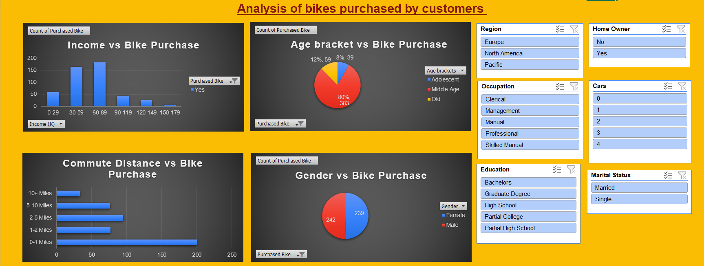
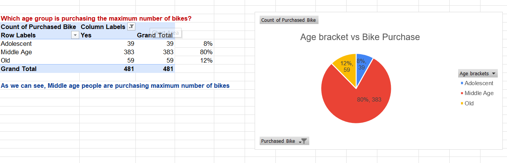
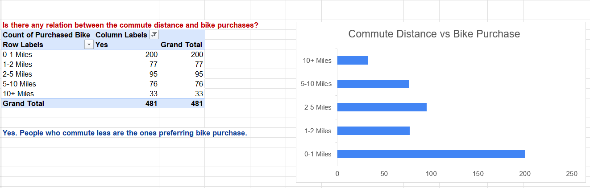
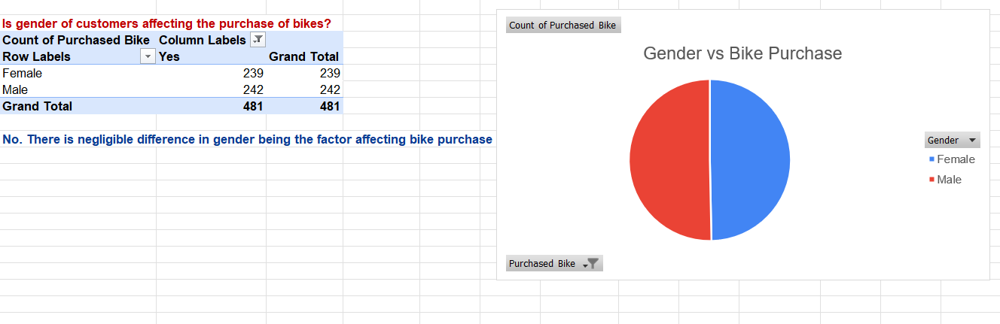
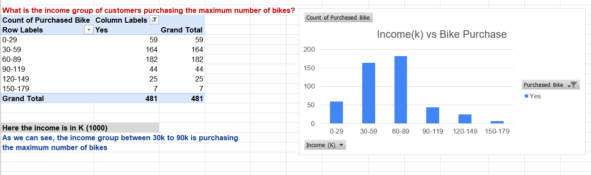

# Bike Purchase Analysis: Interactive Excel Dashboard

An interactive Excel dashboard built with **Pivot Tables, Pivot Charts and Slicers** to understand which customer characteristics are linked to bike purchases, so a sales team can focus on the right customers.



---

## Table of Contents

- [Project Overview](#project-overview)
- [Business Questions](#business-questions)
- [Dataset](#dataset)
- [Methodology](#methodology)
- [Analysis and Key Findings](#analysis-and-key-findings)
- [Recommendations](#recommendations)
- [Interactive Features](#interactive-features)
- [Limitations and Next Steps](#limitations-and-next-steps)
- [Tools Used](#tools-used)
- [Repository Structure](#repository-structure)
- [How to Use](#how-to-use)
- [About Me](#about-me)

---

## Project Overview

A bike retailer wants to know **who is buying bikes**. This project analyzes customer data (demographics, income, commute distance, region and more) and presents the results in a single interactive dashboard that anyone can filter without writing a formula.

Out of all customers in the dataset, **481 purchased a bike**, and this analysis looks at the profile of those buyers.

## Business Questions

1. Which age group purchases the most bikes?
2. Is there a relationship between commute distance and bike purchases?
3. Does gender affect bike purchases?
4. Which income group purchases the most bikes?

## Dataset

- **Source:** _Coding Ninjas Live Bootcamp_
- **Size:** 1,000 customer records, 15 columns
- **Sheet:** `Dataset-Bike-Purchase`


| Column           | Description                                                                   |
| ---------------- | ----------------------------------------------------------------------------- |
| ID               | Unique customer ID                                                            |
| Marital Status   | Married / Single                                                              |
| Gender           | Female / Male                                                                 |
| Income           | Annual income                                                                 |
| **Income (K)**   | _Derived:_ income in thousands (Income / 1000)                                |
| Children         | Number of children                                                            |
| Education        | Partial High School, High School, Partial College, Bachelors, Graduate Degree |
| Occupation       | Clerical, Manual, Skilled Manual, Professional, Management                    |
| Home Owner       | Yes / No                                                                      |
| Cars             | Number of cars owned (0 to 4)                                                 |
| Commute Distance | 0-1, 1-2, 2-5, 5-10, 10+ Miles                                                |
| Region           | Europe, North America, Pacific                                                |
| Age              | Age in years                                                                  |
| **Age brackets** | _Derived:_ Adolescent (up to 30), Middle Age (31-54), Old (55+)               |
| Purchased Bike   | Yes / No (target variable)                                                    |

## Methodology

1. **Explored the data** to understand each column and the target variable (`Purchased Bike`).
2. **Created helper columns** to make the data easier to analyze:
   - `Income (K)`: income converted to thousands
   - `Age brackets`: ages grouped into Adolescent, Middle Age and Old
3. **Built Pivot Tables** (one per business question) filtered to `Purchased Bike = Yes`.
4. **Grouped income** into 30K intervals (0-29, 30-59, 60-89, and so on) for a readable distribution.
5. **Created Pivot Charts** for each pivot table (column, bar and pie charts).
6. **Added Slicers** (Region, Occupation, Education, Marital Status, Home Owner, Cars) and connected them to all pivot tables so every chart updates together.
7. **Designed the dashboard** by combining the charts and slicers on one sheet with a consistent dark theme.

## Analysis and Key Findings

### 1. Which age group buys the most bikes?



| Age Bracket | Bike Buyers | Share |
| ----------- | ----------- | ----- |
| Adolescent  | 39          | 8%    |
| Middle Age  | 383         | 80%   |
| Old         | 59          | 12%   |

**Finding:** Middle-aged customers make up **80% of all bike buyers**, far ahead of the other two groups.

### 2. Does commute distance matter?



| Commute Distance | Bike Buyers | Share |
| ---------------- | ----------- | ----- |
| 0-1 Miles        | 200         | 41.6% |
| 1-2 Miles        | 77          | 16.0% |
| 2-5 Miles        | 95          | 19.8% |
| 5-10 Miles       | 76          | 15.8% |
| 10+ Miles        | 33          | 6.9%  |

**Finding:** Yes. Customers with shorter commutes buy the most bikes. Those commuting **0-1 miles account for about 42%** of buyers, and customers commuting under 2 miles account for about **58%**. Buyers drop sharply beyond 10 miles.

### 3. Does gender affect bike purchases?



| Gender | Bike Buyers | Share |
| ------ | ----------- | ----- |
| Female | 239         | 49.7% |
| Male   | 242         | 50.3% |

**Finding:** No. The split is almost perfectly even, so gender is **not a meaningful factor** in bike purchases.

### 4. Which income group buys the most bikes?



| Income (K) | Bike Buyers | Share |
| ---------- | ----------- | ----- |
| 0-29       | 59          | 12.3% |
| 30-59      | 164         | 34.1% |
| 60-89      | 182         | 37.8% |
| 90-119     | 44          | 9.1%  |
| 120-149    | 25          | 5.2%  |
| 150-179    | 7           | 1.5%  |

**Finding:** The **30K-89K income range accounts for 346 of 481 buyers (about 72%)**. Buyers fall off quickly above 90K.

## Recommendations

- **Target middle-aged customers** (roughly 31-54) in marketing campaigns, since they are the core buyer segment.
- **Focus on customers in the 30K-89K income range** with mid-priced products and offers.
- **Prioritize customers who live close to work** (under 2 miles), for example through local or commuter-focused campaigns.
- **Keep messaging gender-neutral**, since there is no meaningful difference between male and female buyers.

## Interactive Features

The dashboard includes six slicers that filter all charts at once:

| Slicer         | Options                                                                       |
| -------------- | ----------------------------------------------------------------------------- |
| Region         | Europe, North America, Pacific                                                |
| Occupation     | Clerical, Management, Manual, Professional, Skilled Manual                    |
| Education      | Bachelors, Graduate Degree, High School, Partial College, Partial High School |
| Marital Status | Married, Single                                                               |
| Home Owner     | Yes, No                                                                       |
| Cars           | 0, 1, 2, 3, 4                                                                 |

For example, selecting `Region = Europe` and `Occupation = Professional` instantly shows how age, income, commute distance and gender look for that segment alone.

## Limitations and Next Steps

- The analysis counts **buyers only** (`Purchased Bike = Yes`). It shows who buys, but not who is _most likely_ to buy. A next step is to compare buyers against non-buyers in each segment and calculate **conversion rates**.
- The findings above are for the full dataset. The slicers can be used to explore deeper segments such as region, occupation and education.
- Planned improvements: add pivots for education, occupation and number of cars, and rebuild the dashboard in **Power BI / Tableau** for comparison.

## Tools Used

- **Microsoft Excel:** Pivot Tables, Pivot Charts, Slicers, grouping, helper columns, dashboard design

## Repository Structure

```
excel-bike-sales-dashboard/
├── README.md
├── data/
│   └── Bike_Purchase_Dataset.xlsx
├── dashboard/
│   └── Bike_Purchase_Dashboard.xlsx
└── images/
    ├── Screenshot-Dashboard.png
    ├── Screenshot-Data-preview.png
    ├── Screenshot-Age-bracket-analysis.png
    ├── Screenshot-Commute-distance-analysis.png
    ├── Screenshot-Gender-analysis.png
    └── Screenshot-Income-group-analysis.png
```

## How to Use

1. Download `dashboard/Bike_Purchase_Dashboard.xlsx` from this repository.
2. Open it in **Microsoft Excel (desktop version recommended)**, as slicers may not work fully in Excel Online.
3. Go to the dashboard sheet and click the slicer buttons on the right (Ctrl + click to select multiple options) to filter every chart.
4. Click the filter-clear icon at the top-right of a slicer to reset it.

## About Me

**Ritvik Sinha**: Data Analyst skilled in SQL, Python, Excel, Power BI and Tableau.

- LinkedIn: *https://www.linkedin.com/in/sinharitvik*
- Email: *ritviksinha101@gmail.com*
- GitHub: *https://github.com/ritviksinha1/*

Feedback and suggestions are welcome.
